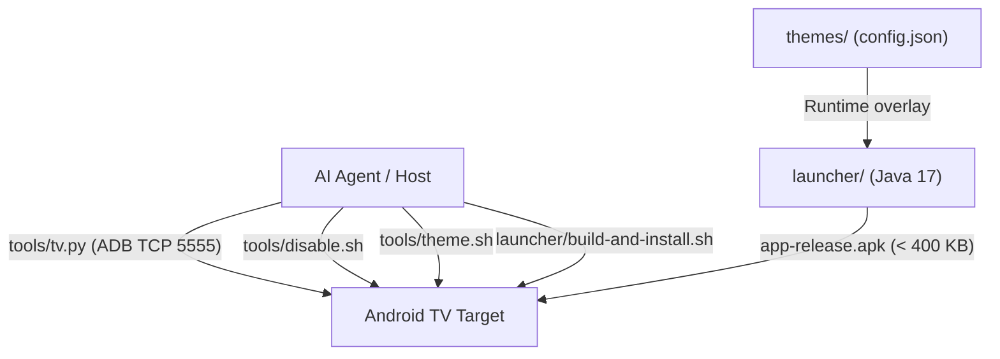

# Agent Guidelines for CleanYourTV

> [!NOTE]
> **TL;DR**: Operational manual and architectural reference for AI agents working on CleanYourTV. Covers devenv environment setup, Android Debug Bridge (ADB) connectivity, debloat safety protocols, launcher engineering constraints, and verification procedures. Status: Active.

## Project Architecture and Subsystems

CleanYourTV debloats Android TV and Google TV devices over Wi-Fi without root privileges. It replaces the ad-supported home screen with a clean, native leanback launcher.



The repository contains five core subsystems:

| Directory | Language / Format | Purpose | Key Constraints |
|---|---|---|---|
| `launcher/` | Java 17, Android SDK | Native leanback TV launcher | MinSdk 26, TargetSdk 34, Android Package (APK) under 400 KB, no Kotlin |
| `tools/` | Python 3, Bash, PowerShell | ADB client and automation scripts | Uses `adb-shell` library, works without host adb binary |
| `examples/` | Text debloat lists | Verified package lists per TV model | One package per line, reversible with `pm disable-user` |
| `themes/` | JSON, JPEG | Visual themes and layout presets | Runtime overlays over `config.xml`, zero rebuild needed |
| `tests/` | Python `unittest` | Safety guards and parsing tests | Runs offline without connecting to a physical TV |

## Development Environment Setup

Agents SHOULD use `devenv` to provision an isolated, reproducible workspace.

| Component | Specification | Provided by |
|---|---|---|
| Python | 3.12 (with `uv`) | `devenv.nix` (`languages.python`) |
| Java | OpenJDK 17 (Temurin) | `devenv.nix` (`languages.java`) |
| Android tools | `adb` 37.0+ | `devenv.nix` (`pkgs.android-tools`) |
| Preferred CLI | `uv`, `rg`, `fd`, `eza`, `jq`, `sd` | `devenv.nix` (`packages`) |
| Android SDK | Platform 34, Build-tools 34.0.0 | `devenv.nix` (`android`, needs `allowUnfree` in `devenv.yaml`) |

### Activate Devenv Shell

1. Enter the reproducible environment with `devenv shell`.
2. Let devenv create `tools/venv` on first entry. On macOS it uses Apple's CommandLineTools Python and rebuilds a venv made with another interpreter.
3. Expect `tools/venv/bin` first on `PATH`, so `python3` has the project dependencies.
4. Run project tasks using predefined shell scripts or direct commands.

```bash
devenv shell
```

> [!TIP]
> Run `devenv shell <script>` directly from the host to execute tasks non-interactively.

### Manual Environment Alternative

1. Create a virtual environment inside `tools/venv`.
2. Activate the virtual environment.
3. Install dependencies from `tools/requirements.txt`.

```bash
uv venv tools/venv
uv pip install -r tools/requirements.txt --python tools/venv/bin/python
```

### macOS Local Network Privacy Protocol

On macOS 15 (Sequoia), Nix and Homebrew Python binaries fail with `OSError: [Errno 65] No route to host` on LAN TCP sockets.
Agents on macOS MUST build `tools/venv` with Apple's CommandLineTools Python if socket connections fail:

```bash
uv venv --python /Library/Developer/CommandLineTools/usr/bin/python3 tools/venv
uv pip install -r tools/requirements.txt --python tools/venv/bin/python
```

## Command Reference

Run the commands below from the repository root:

| Action | Standard Command | Devenv Shortcut | Notes |
|---|---|---|---|
| Run offline tests | `python3 -m unittest discover -s tests -v` | `test-tools` | Verifies shell safety and parsers |
| Build release APK | `cd launcher && ./gradlew assembleRelease` | `build-launcher` | Creates `app-release.apk` |
| Run launcher tests | `cd launcher && ./gradlew testReleaseUnitTest lintRelease` | `test-launcher` | Checks JVM unit tests and Android lint |
| Probe TV hardware | `TV_HOST=<ip> tools/tv.py --probe` | `probe-tv` | Prints model, Android version, and build |
| Run shell on TV | `TV_HOST=<ip> tools/tv.py "<command>"` | `tools/tv.py "<command>"` | Executes a single command on target TV |
| Apply debloat list | `TV_HOST=<ip> tools/disable.sh examples/<path>/debloat.txt` | `tools/disable.sh <path>` | Disables listed packages safely |
| Restore TV packages | `TV_HOST=<ip> tools/restore.sh examples/<path>/debloat.txt` | `tools/restore.sh <path>` | Re-enables packages recorded in backup |
| Install launcher | `TV_HOST=<ip> launcher/build-and-install.sh` | `launcher/build-and-install.sh` | Builds, installs, and sets default Home |
| Apply theme | `TV_HOST=<ip> tools/theme.sh themes/<name>` | `tools/theme.sh themes/<name>` | Pushes `config.json` and wallpaper |
| Reset theme | `TV_HOST=<ip> tools/theme.sh --reset` | `tools/theme.sh --reset` | Restores default built-in `config.xml` |
| Verify closed port | `python3 tools/adb-closed.py <tv-ip>` | `verify-closed-port <tv-ip>` | Confirms ADB port 5555 is closed |

## Safety Directives for TV Package Management

> [!WARNING]
> Disabling critical system services can leave the TV unable to boot or disconnect it from the network.

### Debloating Rules
- Agents MUST NEVER run `pm uninstall` against system packages.
- Agents MUST use `pm disable-user --user 0` exclusively.
- Agents MUST save package and settings state before modifying the TV (`tools/recovery.py`).
- Agents MUST run `pm` commands individually. Chained commands in a single shell call fail silently on Android.
- Agents MUST NOT disable core TV functionality:
  - TV tuner and High-Definition Multimedia Interface (HDMI) input services
  - Remote control pairing and Bluetooth daemons
  - On-screen keyboard input method (`LatinIME`)
  - Google Play Store and Google Play Services
- Before touching streaming apps, voice assistants, or cast services, agents MUST ask the user for confirmation.

### Guarding Setupwraith and Wi-Fi Connectivity
- On Google TV, `com.google.android.tungsten.setupwraith` owns Wi-Fi credentials saved during first-time setup.
- Disabling setupwraith causes Android to delete the saved network immediately, cutting ADB and remote connectivity.
- Agents MUST check network ownership before disabling setupwraith:

```bash
tools/tv.py "dumpsys wifi" | grep -o 'cname=[^ ]*'
```

- If setupwraith appears in the output, the user MUST forget and re-join the Wi-Fi network from Android Settings first.

### Network ADB Port Security
- Port 5555 transmits traffic in plaintext without encryption.
- Devices with `ro.adb.secure=0` expose an unauthenticated shell to every device on the Local Area Network (LAN).
- When finished, agents MUST instruct the user to turn off USB debugging and Network debugging.
- Agents MUST verify the port closed with `python3 tools/adb-closed.py <tv-ip>`.

## Launcher Engineering Rules

### Memory and Size Constraints
- Target devices typically operate with 1 GB of Random Access Memory (RAM).
- The compiled release APK MUST remain under 400 KB (409,600 bytes). Continuous Integration (CI) enforces this limit strictly.
- The launcher codebase MUST remain pure Java 17.
- Agents MUST NOT add Kotlin dependencies, Jetpack Compose, or heavyweight libraries.
- The launcher MUST NOT perform background network polling, background services, or video playback.
- The launcher MUST NOT employ expensive blur shaders or complex Graphics Processing Unit (GPU) filters.

### Configuration Separation
- Hardware-specific TV behaviors MUST be configured in `launcher/app/src/main/res/values/config.xml` or runtime theme JSON files.
- Agents MUST NOT hardcode TV brand or model checks into Java source files.
- Remote keycode mappings belong in `settings_key_keycodes`, `input_key_keycodes`, or `app_keys`.

### Navigation Determinism
- Directional pad (D-pad) navigation MUST behave deterministically.
- Pressing Up or Down MUST navigate by exactly one row.
- Pressing Up from the dock MUST focus the top bar.
- Top bar edges MUST NOT fall through to unrelated tiles.
- The launcher MUST preserve the last focused tile across sessions.

## Verification and Testing Protocols

> [!IMPORTANT]
> Visual confirmation via screenshots is required before declaring a task complete.

### Visual Screen Capture Verification
1. Inject remote navigation keyevents via `tools/tv.py`.
2. Capture the current TV screen with `screencap -p /sdcard/s.png`.
3. Pull the screenshot file to the local workstation with `tools/tv.py --pull`.
4. Inspect the image to confirm correct layout, focus rendering, and typography.

### Live TV and HDMI Screenshot Handling
- Android hardware overlays for HDMI and Live TV tuner feeds capture as 0 bytes or black rectangles.
- A blank screenshot does not indicate a broken debloat.
- Check active window focus instead:

```bash
tools/tv.py "dumpsys activity activities" | grep topResumedActivity
```

### Accessibility Helper Verification
- Remote button remapping relies on `HomeKeyService` and `InputKeyService`.
- Injected `input keyevent` commands bypass accessibility services.
- Agents MUST check service binding status via `dumpsys accessibility`.
- Agents MUST ask the user to press the physical remote button to confirm real behavior.
